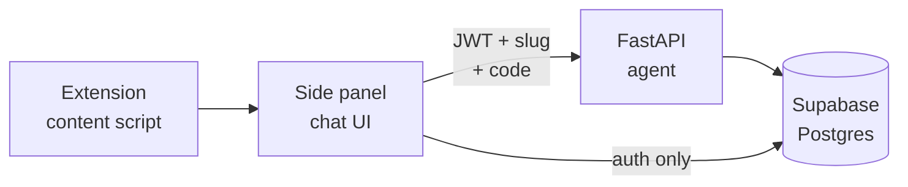

# Design Choices

A running log of architectural decisions and the reasoning behind them.

_Last updated: 2026-10-06_

## How to read this

Each entry states the situation, the decision, the reasoning, and what it costs.
Entries are self-contained, so you can read one without the others.

A decision here isn't permanent. When one turns out wrong, add an entry that
supersedes it rather than editing history — reasoning that led somewhere wrong
is usually worth keeping.

---

## Chrome extension, not a standalone web app

Build the product as a browser extension that overlays leetcode.com, rather than
a Next.js site that hosts its own problems and code editor.

**Context.** The original plan was a web app with its own problem catalog, editor
and judge. That required solving test-case correctness from scratch: sourcing
problems, authoring test suites, and running untrusted code in a sandbox.

**Why.** The extension doesn't solve the test-correctness problem — it deletes
it. LeetCode's own judge becomes the oracle, and it's the one users already trust
and will be graded against in real interviews. It also gives the agent signals a
standalone app structurally cannot get:

- The real verdict. `Time Limit Exceeded` and `Wrong Answer` are completely
  different coaching conversations — TLE means the logic is right and the
  complexity is wrong.
- Which test case failed, and what it expected.
- The code as it is being written, not after the fact.

**Cost.** Dependence on a platform we don't control. LeetCode's DOM can change,
they can block extensions, and they are shipping their own AI assistant.
Mitigated by reading their GraphQL API rather than the DOM (see below), and by
accepting that this is a real risk rather than engineering around it.

**Consequence.** No code execution, no test authoring, no problem catalog, no
comparator design. Roughly three sessions of research into TACO, HackerRank and
test-generation pipelines became unnecessary.

**Status.** The Next.js app in `frontend/` was kept parked as a reference and a
possible home for a progress dashboard, then deleted on 2026-09-27 — nothing
used it, and a dead folder in a resume repo invites the wrong question. If a
web surface is ever wanted, it starts fresh. Its nested git repo went with it.

---

## `@supabase/ssr` → `@supabase/supabase-js` + `chrome.storage`

Drop `@supabase/ssr` and use `@supabase/supabase-js` with a custom storage
adapter over `chrome.storage.local`.

**Context.** The working login in `frontend/` uses `createBrowserClient` from
`@supabase/ssr`, server actions marked `"use server"`, and `src/proxy.ts` for
route protection. None of it survives the move to an extension.

**Why.** `createBrowserClient` is not "the browser version of Supabase." It is
the browser half of a server-rendering handshake: it writes the session into
`document.cookie` so that a server can read that cookie on the next request and
rebuild the same session server-side. That is its entire reason to exist.

An extension has no rendering server, so the handshake has no other side. Cookies
are also the wrong medium here — the side panel runs on `chrome-extension://<id>/`,
its own origin. A cookie set there is invisible to the service worker and
meaningless to leetcode.com.

Every Next-specific piece fails for the same underlying reason, not four separate
ones:

| In `frontend/` | Why it can't come | Replacement |
| --- | --- | --- |
| `createBrowserClient` | Persists the session to cookies for a server to read back | `createClient` + `chrome.storage.local` adapter |
| `"use server"` actions | Compiles to an RPC to a server that doesn't exist | Plain `async` submit handler |
| `useActionState`, `revalidatePath`, `redirect` | Assume a server round-trip and a server router | `useState` + conditional render |
| `src/proxy.ts` | Intercepts HTTP requests before render; a panel is a static file | `session ? <SignedIn/> : <LoginForm/>` |

**What makes the adapter work.** Supabase's `auth.storage` option takes
`SupportedStorage` — `getItem`, `setItem`, `removeItem` — and those methods are
allowed to return promises. That is the detail that matters: `chrome.storage` is
async while `localStorage` is not, so without promise support this approach would
not be possible at all.

Also set `detectSessionInUrl: false`. There is no OAuth fragment to parse in a
panel.

**What is unchanged.** The Supabase project, the users, RLS, and the local stack.
The `signInWithPassword`, `signUp` and `signOut` calls are identical — same
functions, same arguments, same error shapes. The form markup in
`frontend/src/app/login/page.tsx` ports over almost verbatim.

**Cost.** About an hour of Next-specific wiring is discarded. The auth _workflow_
is not rebuilt, only its plumbing.

---

## Agent logic lives in the backend, not the extension

Prompt construction, history retrieval and the Claude call all happen in
`backend/` (FastAPI). The extension reads the page, renders the chat, and holds
the session.

**Context.** The extension could do this work itself: query Supabase directly for
history, build the prompt client-side, and use the backend as a thin forwarding
proxy.

**Why.** Chrome Web Store review takes days. Prompt logic inside the extension
means every tweak is a new version and a wait in a review queue — and the system
prompt will be tuned dozens of times in the first month. On the server it is a
`git push`.

Secondary reasons: the system prompt stays private rather than sitting in a
bundle anyone can unzip, and the server holds the service role key, so it can
write assistant messages that RLS forbids the client to forge.

**Division of labour.**



The extension uses `supabase-js` for authentication and simple history reads. The
backend verifies the Supabase JWT, does retrieval, calls Claude, and writes the
turn back.

**Consequence.** The extension gets thinner, not thicker. `patterns.json` also
lives server-side for the same reason — a mislabelled problem can be fixed
instantly instead of shipping a release.

**Cost.** A server to run and pay for. Bring-your-own-key would avoid that, but
then the project has no backend in it at all, which is a visible gap if the
target is backend or full-stack roles. Resolved in the next entry.

---

## One Anthropic key, held by the backend — not bring-your-own

The backend holds a single Anthropic API key in its environment and pays for
every request. Users never see or handle a key.

**Context.** The alternative is the "insert your own key" model common in
frontend-only AI products. Those products have nowhere to hide a key, so the
model is a constraint for them rather than a choice. With a backend (previous
entry) the constraint does not apply, which turns this into a real decision.

The two questions are independent: *where the Claude call runs* (settled:
backend) and *whose key pays*. This entry is only about the second.

**Why.**

- The demo has to work for strangers. Interviewers will not paste an API key
  into an unknown extension, and most LeetCode users do not have one — getting
  one means a Console account and a credit card. BYO-key makes the product work
  for exactly one person.
- It is the better engineering story. Holding the key forces the backend to
  solve JWT verification, per-user quotas, rate limiting, spend caps and usage
  logging. A BYO proxy solves none of them.
- BYO-key has its own security problem: a long-lived key in `chrome.storage`
  is readable by anyone at that browser.

**Cost.** Rough planning estimate per hint — ~3,000 input tokens and ~1,000
output tokens including thinking; measure once the prompt exists:

| Model | Per hint | Per active user / month* |
| --- | --- | --- |
| Claude Opus 5 (default) | ~$0.04 | ~$4 |
| Claude Sonnet 5 | ~$0.016 | ~$1.60 |
| Claude Haiku 4.5 | ~$0.008 | ~$0.80 |

\*10 hints per session, 3 sessions a week. Prompt caching on the system prompt
and statement brings real numbers below these. Start on Opus 5; step down only
on measured spend, not on a guess.

**Controls that make it safe** — signup is open, so without these any stranger
can spend the budget:

1. A monthly spend limit in the Anthropic Console, set before the backend
   exists. The guarantee against a surprise bill regardless of what ships.
2. A per-user daily hint quota, enforced server-side and tracked in Supabase.
3. A per-user rate limit — a few requests a minute.
4. `usage` from every response logged to Supabase, so cost per hint is a
   number rather than a feeling.
5. Prompt caching on the stable prefix, and `effort` tuned for hints.
6. The Supabase JWT is verified before Claude is called — already decided.

**Door left open.** The key is resolved per request through one function that
today returns the environment variable. A "bring your own key for unlimited
use" tier later is a settings field and a one-line change, not a redesign. Not
built now.

**See also.** *Two interchangeable model providers* below — "the key" is now
whichever vendor `LLM_PROVIDER` selects. The reasoning here (backend holds it,
users never do) is unchanged.

---

## Two interchangeable model providers, one tutor

`backend/app/providers/` holds one module per vendor — `claude.py` (Anthropic,
Messages API) and `gpt.py` (OpenAI, Responses API) — behind one contract,
selected by `LLM_PROVIDER` in `.env`. The tutor itself lives in
`app/prompt.py` and is shared, so switching vendors changes plumbing and
nothing the user experiences.

**Context.** Two corrections to earlier entries prompted this. Anthropic's API
has no free credit — the "$5 for new accounts" repeated above came from
secondary sources and the Console simply asks for a prepaid block. And OpenAI
offers free daily tokens (reportedly 1M/day on large models) in exchange for a
data-sharing opt-in. Whether that offer is real for this account, and whether
GPT holds the hint ladder under pressure as well as Claude does, are questions
worth answering with the same backend rather than two.

**Shape.**

| Shared (vendor-neutral) | Per provider |
| --- | --- |
| `prompt.py`: rules, problem block, code block | SDK client and its lazy, fail-clear construction |
| `schemas.py`: request/response, size limits | How the prompt is laid out for that API's caching |
| `providers/base.py`: `Provider` protocol, `ProviderError(status, detail)` | Translating the SDK's exceptions into `ProviderError` |
| `main.py`: auth, route, usage log — imports no vendor SDK | Reading the reply, refusal and cut-off signals |

Each provider's SDK is imported only when selected, so the other can be absent
or misconfigured with no effect.

**What the abstraction does not hide.** These differ by vendor and are
documented in each module rather than papered over:

- Prompt caching: Anthropic needs an explicit breakpoint after the problem
  statement; OpenAI caches matching prefixes automatically. Both providers
  order the prompt stable-first, so both benefit.
- Refusals: Anthropic's server-side fallback re-runs a declined request on
  another model; OpenAI returns a `refusal` part and the user sees a fixed
  message.
- Usage: OpenAI reports cached input but has no cache-write charge, so that
  field is always zero for it.

**Cost.** Two SDKs to keep current, and every provider-facing test runs twice.
Accepted because the alternative — rewriting one file each time the vendor
question comes up — is worse, and because the comparison itself is the point.

**Status.** Verified without spending: both providers import, `/health` reports
the active provider and model, the OpenAI input shape and reply parsing (text,
refusal, cut-short) are checked against constructed SDK objects, and a missing
key yields a 503 on either. Live calls await keys.

**Update 2026-09-29.** OpenAI is the active provider, on its data-sharing
program (see the next entry). Anthropic stays wired in as the alternative.

---

## Data-sharing disclosure: implied consent in the empty chat

The backend runs on OpenAI's data-sharing program — free daily tokens in
exchange for letting OpenAI train on the traffic. Users are told this in the
chat itself before their first message, and sending a message is the act of
agreeing. The same notice is reachable any time from a Privacy button.

**Context.** OpenAI's Content Sharing Agreement makes the customer warrant that
end users have been given notice and that consent has been collected, and that
a copy of the notice will be provided to OpenAI on request. Enrolment is
org-wide: everything sent through the key is designated content, with no
per-request opt-out. So the moment anyone other than the developer uses the
extension, a notice is a contractual obligation, not a courtesy.

**Decision.**

- The notice is the placeholder content of the empty chat — the one place a
  user is guaranteed to look before typing. It disappears once the first turn
  exists and reappears whenever the chat is empty (new panel session, new
  problem).
- Its wording lives in one component, `extension/src/panel/Notice.tsx`, so
  there is exactly one Notice and git history is its record.
- It says what is sent (statement, editor code, chat), what is never sent
  (login and account details), that OpenAI may train on it, not to include
  secrets, and that the user must be 13 or older.
- A Privacy button in the header shows the same text on demand, so it is
  always findable, not just shown once.

**Why implied rather than express consent.** A checkbox-and-continue gate is
stronger evidence — it records that a specific user accepted a specific version.
It also adds a screen, a stored acceptance, and versioning. For a project at
this scale, an unavoidable notice plus an affirmative act (sending) is
proportionate, and it is what most consumer software does. The backend already
logs every chat with the user id and a timestamp, so "sent a message after
seeing the notice" has a record once that log is persisted.

**Upgrade path, if it is ever needed:** a one-time gate after login, acceptance
stored in Supabase user metadata (`consent: {version, accepted_at}`) so it
travels in the access token, and a check in `auth.py` so the backend refuses
`/chat` without it — enforcement at the money boundary rather than in the UI.

**Obligations this creates.**

- Publishing to the Chrome Web Store additionally needs a privacy policy URL
  and the listing's data-use disclosure. Same facts, different document.
- The agreement forbids Protected Health Information and personal data of
  children under 13 — hence the age line.
- **The notice is only true for OpenAI.** Anthropic's API does not train on
  requests by default. Switching `LLM_PROVIDER` back means changing the text,
  or making the panel read the active provider from `/health` and adapt.

**Cost.** Weaker evidence than a checkbox, and a paragraph of text in what
should be an inviting empty state. Accepted for now; revisit before any public
release.

---

## Benchmarks: measure before tuning

Every model call is recorded — timing, tokens, reasoning tokens, estimated
cost, the exact prompt and the reply — and a fixed set of canned requests can be
replayed to compare configurations on identical input. The report in
`docs/benchmarks.md` is generated from those records, never written by hand.

**Context.** The first real chat cost about $0.02 and took several seconds, and
the only trace of it was one line in a terminal. There was no way to see where
the money went, where the time went, or whether a change (effort level, model,
provider) made things better or worse.

**What is measured, and why each one.**

| Metric | Why |
| --- | --- |
| `model_ms` | The provider call alone: the number to compare across configurations |
| `backend_ms` | The whole route, timed from a middleware that runs before validation and auth. The gap to `model_ms` is what the backend itself costs, and should be negligible — this proves it |
| `round_trip_ms` | Measured in the panel from clicking send, so it includes the token refresh and the network. The user's actual wait |
| `reasoning_tokens` | The number that explains the cost. Reasoning is billed as output and is most of the latency. OpenAI reports it; Anthropic folds it into `output_tokens` |
| `cache_read` / `cache_creation` | Whether prompt caching is actually working across a session |
| `cost_usd` | Estimated from a hand-maintained price table, `None` for an unknown model rather than a guess |
| the prompt and the reply | Qualitative review: did it hint, or did it answer? |

Time-to-first-token is not measured; it needs streaming.

**One normalisation that matters.** OpenAI counts cached tokens *inside*
`input_tokens`; Anthropic reports them separately. `Usage.input_tokens` is
therefore defined as *uncached* input for both, so a single cost formula works
whichever vendor answered. This is why the OpenAI provider subtracts
`cached_tokens` before filling the field.

**Where the records go.**

- `backend/benchmarks/runs.jsonl` — one line per call. Gitignored, because it
  contains prompts and user code. `BENCHMARKS_PATH=` empty disables it.
- `docs/benchmarks.md` — generated by `python -m app.benchmarks report`:
  a summary per (source, provider, model, effort) with p50/p95 latency, mean
  tokens, cache hit rate and cost, then the most recent calls verbatim.
  Committed, so the numbers live in the repo.
- The panel — a muted line under each reply with model, seconds, tokens and
  cost, so the cost of a hint is visible where the hint is.

**The replay runner.** `benchmarks/cases.json` holds five fixed requests chosen
to cover the behaviours that matter: a blank start, a real bug, pressure for
the full answer, a multi-turn follow-up, and a correct-but-slow solution.
`python -m app.benchmarks run` calls the provider directly — no HTTP, no
auth — and records rows tagged `bench` so they never mix with real usage. It
prints a cost estimate and refuses to spend without `--yes`.

**`LLM_EFFORT`.** One optional setting, passed to both vendors only when set
(they accept the same five levels: low, medium, high, xhigh, max). It is the
biggest single lever on latency and cost, and the benchmark exists largely to
measure it. Unset means the provider default, so adding the setting changed
nothing by itself.

**Cost.** A price table that goes stale silently — it carries a date and a
warning for that reason. And the JSONL grows without bound; fine for one
developer, something to rotate before there are users.

---

## Accepted submissions: detected automatically, saved by the backend as the user

When LeetCode accepts a submission, the extension notices by itself and the
backend stores the accepted code with a short model-written summary. There is
no "save" button. This is the project's first table.

**Context.** The tutor is meant to refer back to problems the user has already
solved. Nothing was persisted: `supabase/` held only `config.toml`. The summary
is deliberately simple for now and will be improved later.

**Detection.** After Submit, LeetCode moves to
`/problems/<slug>/submissions/<id>/`. The content script already watches URL
changes, so that URL is the trigger; the verdict comes from LeetCode's
`submissionDetails` GraphQL query, same-origin with the user's session — the
same mechanism as the problem statement. LeetHub-2.0, an existing extension,
reads the id from the same URL pattern and uses the same query.

Validated by a spike on a live account (2026-10-01, `number-of-islands`):

| Asked | Answer |
| --- | --- |
| Does the URL change after Submit? | Yes |
| While LeetCode is judging | `statusCode` 16 (first two polls, ~3s) |
| Once accepted | `statusCode` 10 |
| Is `code` the judged code? | Same length as the editor's contents |

So the script polls while the status is 16 and stops at any other; 10 is
accepted. Submission ids are already past the 32-bit range and LeetCode's
`Int!` variable takes them anyway. Not yet observed: the final status of a
wrong answer — anything other than 10 is treated as not accepted.

**Why automatic rather than a button.** The query returns the exact code that
was judged; a button would send whatever is in the editor at the moment of the
click and could not confirm it was accepted. It also depends on the user
remembering.

**Who does the saving.** The content script holds no auth, so it only leaves
the submission in `chrome.storage.local` under `accepted:<id>`; the panel,
which holds the session, sends it to the backend and removes the key. One key
per submission rather than one list: the content script only adds keys and the
panel only removes them, so neither can overwrite a change the other just
made. Consequence: a submission accepted while the panel is closed is saved
the next time it opens. Saving from the service worker would remove that gap
and is not built.

**The backend writes as the user.** `POST /solutions` forwards the caller's own
Supabase token to Supabase's REST API, with the public anon key identifying
the project. Row-level security on `solutions` (read own, insert own) then
decides what the call may touch, and the backend holds no elevated database
credential. This supersedes the line in *Agent logic lives in the backend*
that has the server holding the service-role key. Rejected:

- The service-role key: simple, but a second powerful secret in `backend/.env`
  that bypasses row-level security entirely.
- The extension inserting the row itself: no backend change, but the save
  logic would be split between the place that writes the summary and the
  place that stores it, and retrieval of similar problems will live in the
  backend anyway.

**What is stored.** The accepted code, the summary and the model that wrote
it, the problem's slug, title, number, difficulty and LeetCode topic tags, and
the language. The code is kept so summaries can be regenerated when the way
they are written improves.

**Trust.** That a submission was accepted is the extension's word. The backend
has no LeetCode session to check it with, and the row belongs to the caller,
so a forged "accepted" only pollutes the forger's own history.

**Cost controls.** The backend looks the submission up before calling the
model, so re-opening an old accepted submission (which triggers detection
again) costs nothing. It also skips a submission whose code is identical to
one already saved for the same problem: LeetCode gives every Submit a new id,
so without this, resubmitting the same code would add a duplicate row and pay
for a second summary. A different accepted approach to the same problem is
still its own row. `unique (user_id, submission_id)` makes the insert
idempotent. Summaries always run at effort `low` regardless of `LLM_EFFORT`,
and the request has the same size caps as chat.

**The privacy notice changed with it.** Accepted code now goes to OpenAI and
is stored without the user sending a message, so the notice says so, and the
agreeing act is "using LeetCode AUX" rather than "sending a message". Saving
only happens with the panel open, which is where the notice is shown.

**Cost.** Another dependence on an undocumented LeetCode endpoint; one model
call per accepted submission; and stored user code, which is more to be
responsible for than a transcript that vanishes with the panel.

**HTTP client.** The REST calls use `httpx2`, the Pydantic-maintained
continuation of `httpx`. Both model SDKs already depend on it, so it adds no
new library; it is declared explicitly because `app/db.py` imports it.

**Status.** Built 2026-10-01. Verified without spending: the backend imports,
`/solutions` answers 401 without a valid token, the request schema rejects
empty code, and the extension builds. The end-to-end run — table migrated,
accepted submission saved, repeat submission not re-summarised, wrong answer
ignored — is still to do.

**Update 2026-10-03.** Verified end to end: Two Sum and Add Two Numbers saved
with summaries; resubmitting Two Sum unchanged was recognised as the same code
and not stored again; a wrong answer (`statusCode` 11) saved nothing.

---

## Recall: tag overlap, summaries only

On every chat message, the backend looks up the user's saved solutions whose
LeetCode topic tags overlap the current problem's, and puts up to three of
their summaries into the prompt. The tutor can then say "you solved Two Sum
with a hash map — the same idea applies here", or "you have solved this one
before." This is the first time saved solutions feed back into hints.

**Context.** Solutions were being saved (previous entry) and never read. The
feature the product is named for — remembering what you have solved — needed
retrieval of some kind, and the obvious one, embeddings, is far more
machinery than two rows justify.

**Similarity is topic-tag overlap, for now.** LeetCode's tags are already
stored with every saved solution, so this needs no new data. Rows are ranked:
the same problem first, then the number of shared tags, then recency; one row
per problem; at most three. Tags that nearly every problem carries — `Array`,
`String` — are ignored, because overlap on them alone says nothing. If the
current problem has no other tags, recall falls back to looking for the same
problem, so "you have solved this before" still works.

This puts tags ahead of the NeetCode pattern map that *NeetCode's pattern map
for "similar problems"* chose. The reasoning there — one curated pattern beats
five overlapping tags for coaching — still holds; what changed is the order of
work. Tags are free today; the pattern map needs a 188KB file in the backend
and covers about 450 problems. The upgrade path, in order: the pattern map
when tag matching proves too coarse, `pgvector` when the pattern map does.

**Summaries only, never code.** The tutor sees each recalled problem's name,
tags, difficulty and saved summary. Showing it the user's old code would
invite it to quote that code back, which the no-code rule exists to prevent,
and would cost a few hundred tokens per recalled solution on every message.
The summary was written for exactly this use.

**Where it sits in the prompt.** Inside the problem block — after the
statement, before the transcript. That keeps it under the Anthropic cache
breakpoint and inside OpenAI's stable prefix: it changes only when a new
solution is saved, not per message.

**Recall never breaks chat.** A database failure (stack down, anon key
missing) is logged as a warning and the tutor answers without it. The panel
shows `recalled: …` under each reply, so whether recall worked is visible
without reading logs.

**Cost.** One database read per message (negligible), and up to three short
summaries of prompt tokens. Tag overlap is coarse: `Hash Table` links Two Sum
to many problems that share little else. That is the known limitation the
upgrade path exists for.

**Status.** Built 2026-10-03; verified offline (ranking, prompt block, the
route with a fake database, graceful failure). Live check: open a Hash Table
problem with Two Sum saved and see `recalled: 1. Two Sum`.

---

## The hint ladder and intent rules: tuning the tutor by replay

The tutor's rules are numbered hint levels and short imperative limits, and
every change to them is judged by replaying a fixed set of cases and reading
the replies against a written expectation. Four prompt versions in four days
(2026-10-03 to 06); this entry records what each one was for.

**Context.** The first prompt was short and vague — "escalate gradually",
"a few sentences" — and the benchmark log of sixteen real chats showed what
vague buys: praise openers in five replies ("Great place to start" to a user
who typed "help" into an empty function), the whole strategy handed over on
the first message ("think sort + two pointers"), the same hint repeated three
times to "another one", replies of 90–140 words, and off-topic questions
answered. Two days later a second failure: with code in the editor, a direct
question about the user's own reasoning got "Level 4 hint: reconsider two
spots…" — no answer, and the same two points for the third reply running.

**Method.** `benchmarks/cases.json` holds frozen moments of a chat (problem,
editor code, transcript, optionally recalled solutions) with an `expect` line
each. Most are the failures above, turned into tests. A prompt change is
replayed against every case, the report puts each case's replies side by side
per prompt version, and the judging is by reading — no automatic grading and
no LLM judge, chosen deliberately: rules can't catch "gave the whole approach
in the form of a question", and a grader model adds cost and its own errors.
`PROMPT_VERSION` is recorded with every call so versions stay comparable.
Replays cost a few cents each; the whole exercise about fifty.

**The shape of the prompt.** Two ideas, both kept as short as the cases
allow:

- *Five hint levels, one per reply*: the kind of problem plus one question;
  the key observation; the technique; the steps in words; a specific line of
  their code. "Another hint" is the next level; a bare starter signature
  counts as nothing written; never repeat a point, say it more plainly.
- *First decide what they are asking.* A hint, a yes/no question about an
  approach, a question about their own reasoning or code, a question about
  something the tutor said, "why does this fail", "can it be better", or
  off-topic — each with a one-line rule. The direct-question rule is "say
  whether it's right, then name the one flaw: what is wrong, not how to fix
  it", which is the strength of answer Mauko chose.

**What each version did.**

| Version | Change | Result on the replay set |
| --- | --- | --- |
| 1 | the original | praise, length, whole approaches, repeats, off-topic answered |
| 2 | numbered ladder, hard limits, no praise, off-topic rule | fixed all of those; but "with real code, work at level 4" made every message a hint request, and level labels leaked into replies |
| 3 | intent rules | direct questions answered, "still not working" gets something new, scaffolding no longer critiqued; one regression: a bare yes/no question got the whole method as "the gap" |
| 4 | yes/no split from reasoning questions; "can it be faster" stops at the limit; labels and lists banned | 13 of 17 clearly meet their expectation, three are borderline (judgment calls below), and one regressed: "still not working" asked the previous question again instead of stating what the code still lacks — one run, so noise is possible |

Cost per reply barely moved between versions ($0.0075 → $0.0060 → $0.0064 on
the same eleven cases); what moved it was the *kind* of question. Cases with
real code and a hard question spend about 1,200 tokens reasoning and cost
$0.014, more than double the simple ones, under every version.

**Still open.** Whether "name the flaw" may extend to the fix in words (the
version 4 reply names the flaw but describes it imprecisely; version 3 was
precise but gave the fix). And whether the ladder should descend after a
turn that was an answer rather than a hint — the case that tests it was
built ambiguously.

**When this stops being a prompt problem.** A cheap classifier call that
labels each message, with a category-specific prompt and per-category effort,
is the next design — but only if the replays show the single prompt routing
wrong (a hint in answer to a question, or the reverse). After version 4 they
don't. The cost finding above is the stronger argument for it, or simply for
`LLM_EFFORT=low`, which the same replay set can now judge.

---

## First working chat: `POST /chat`, verified by JWKS, deliberately unstreamed

The first end-to-end milestone (2026-09-22): the panel sends the transcript
plus the captured problem and code to `backend/`, which calls Claude with the
backend's key and returns the reply. Three decisions inside it are worth
keeping.

**Tokens are verified against Supabase's JWKS, not a shared secret.** The
first version verified HS256 with the local stack's well-known JWT secret. The
first real token rejected it: current Supabase — the local CLI included — signs
access tokens with ES256 and publishes the public key at
`/auth/v1/.well-known/jwks.json`. Verification now fetches and caches those
keys; an HS256 path remains for instances still configured that way, selected
by the token's `alg` header against an allowlist. The anon key, a JWT from the
same issuer with `aud: anon`, is rejected by the audience check.

**Prompt layout is chosen for caching.** The cache is a prefix match, so the
system prompt holds the stable content — rules, then the problem statement with
the cache breakpoint — and the user's current code rides in the *last* user turn
as a separate text block. Putting the code anywhere earlier would invalidate
the cache on every keystroke.

**Update 2026-10-03: the transcript was breaking its own cache.** The first
live check of cache hits showed `cache_read=0` on every message. The benchmark
log, which records each full prompt, showed why: the newest user turn was sent
as `[code, message]` and then, once it became history, as a plain `message`
string. The cache compares a request with the previous one from the start
and stops at the first difference, so matching stopped at the start of the
previous turn. Fixed by shaping every user turn the same way — a list of text
parts, message first: `[message, code]` when newest, `[message]` as history
— so the only difference between consecutive requests is the code at the
end. The gain is one message of cached text per turn; the larger fact is that
the cacheable part must reach the vendor's 1,024-token minimum on its own,
which a short problem only does a few turns in.

**Refusal fallback is on.** `fallbacks: "default"` re-runs a safety-declined
request on Anthropic's recommended fallback model server-side, so a user gets an
answer rather than a refusal.

**Deliberately not in this milestone.**

| Left out | Why now, and what it costs |
| --- | --- |
| Streaming | One JSON round trip is simpler to debug. Cost: a visible pause of several seconds per reply. First thing to add once the loop is proven. |
| Persistence | Transcript lives in panel state; closing the panel ends the chat. |
| Quota, rate limit | The schema's size limits are the only cost control in code. The Console spend cap is the real one until these land. |

The size limits on the request schema are not cosmetic: every byte a client
sends becomes prompt tokens billed to the backend's key.

**Status.** Verified without a key: health, auth accept/reject (real token,
anon key, tampered payload), validation, and a clear 503 when no key is
configured. The Claude call itself awaits a key in `backend/.env`.

---

## Read problems via LeetCode's GraphQL, with DOM as fallback

The content script POSTs to `leetcode.com/graphql` same-origin using the user's
own session. DOM selectors stay as a secondary path.

**Context.** The obvious approach is scraping the page. It is also the fragile
one: LeetCode's class names are hashed build output that changes without notice,
and the statement is React-rendered so it is absent from the initial HTML.

**Why.** A content script running on leetcode.com can call their own API
same-origin with the user's cookies. It returns structured data — `title`,
`questionFrontendId`, `difficulty`, `topicTags`, and clean statement HTML —
instead of text scraped out of styled divs.

**Validated.** The spike ran both strategies and reported which won. On
`number-of-islands`:

| Strategy | Result |
| --- | --- |
| GraphQL | OK — full structured payload |
| DOM | statement found, `document.title` gave the name |
| Verdict | `graphql` |

Both paths work today, so the fallback is real rather than theoretical.

**Bug the spike caught.** Tracking `location.href` for navigation fires on every
tab switch between Description / Editorial / Submissions, because LeetCode
rewrites the URL without changing the problem. That meant a redundant GraphQL
request per tab click. Fixed by tracking the slug instead.

**A second bug, found while porting the spike.** The spike wrapped
`history.pushState` to notice SPA navigation. That can never work from a content
script: the isolated world has its own JavaScript wrappers around DOM objects, so
the wrapper replaced a copy of `pushState` that LeetCode's router never calls.
Navigation detection appeared to work only because a 1-second fallback poll was
quietly doing the whole job. Replaced with a `currententrychange` listener on the
Navigation API — events, unlike property overrides, are delivered to every world
— with the poll kept as insurance.

**Content script matches all of `leetcode.com`, not just `/problems/*`.** Content
scripts inject on page load. Landing on the problem list and clicking into a
problem is an SPA transition with no page load, so a `/problems/*` match would
never inject. The script no-ops until the URL is a problem page.

**Cost.** An undocumented endpoint can go behind auth at any time. The DOM
fallback is the insurance, and it is why both paths are kept rather than deleting
the loser.

---

## Read the editor from a MAIN-world script, bridged over `postMessage`

A second content script declared with `"world": "MAIN"` reads the user's code
from `window.monaco` and posts it to the isolated-world script, which stores it.

**Context.** The agent needs the code as it is being written. Two facts rule out
the obvious approaches: content scripts run in an isolated world and cannot see
page globals like `window.monaco`; and Monaco virtualizes rendering, so the DOM
only ever holds the lines currently scrolled into view.

**Why.** Chrome's `"world": "MAIN"` option runs a content script in the page's
own JavaScript context, where Monaco's API is reachable — the model's
`getValue()` returns the complete buffer, and `onDidChangeContent` makes it live.
The price is that `chrome.*` is unavailable there, so the result crosses back
over `window.postMessage` (same-origin target) to the isolated script, which
alone touches `chrome.storage`.

**Choosing the editor.** LeetCode may hold several Monaco instances. The one the
user is typing in is the largest visible one with a model. Older Monaco builds
lack `getEditors()`; then the fallback is the model with the most non-plaintext
content.

**No fallbacks — loud failure instead.** The first version shipped two
degraded paths for when Monaco was unreachable: LeetCode's `localStorage` draft
(complete but possibly stale) and a scrape of the rendered `.view-line`
elements (current but partial by construction). Both were removed the same day,
once the Monaco path was confirmed working, for three reasons:

- They were never exercised — Monaco worked on the first run — so they were
  untested code posing as insurance.
- For a tutor, wrong context is worse than no context. Stale or truncated code
  produces confidently wrong hints, and nobody notices for a while. A visible
  "can't read the editor" gets reported and fixed the same day.
- The realistic failure — LeetCode stops exposing `window.monaco` — would need a
  different MAIN-world technique to fix, not a storage scan.

This is a different call from the problem statement, where the DOM fallback
stays: statements are not virtualized, so that path is complete, and they do
not change under you.

If nothing arrives within 6 seconds, the capture is recorded as `unavailable`
with a reason, and the panel says so.

**Trust boundary.** The MAIN-world script is the least trusted code in the
extension: page scripts can see and call it. It holds no secrets and no auth
state, and its messages are treated as data — the code is rendered as text,
never executed. A page script could spoof a message; the worst outcome is a
wrong capture.

**Build.** IIFE output cannot code-split, so the two content scripts cannot share
one Vite pass. `vite.content.config.ts` is a function of `--mode` and runs once
per script.

**Status.** Validated 2026-09-21: `window.monaco` is a global on LeetCode, the
editor API is present, and the panel updates live as the user types.

---

## NeetCode's pattern map for "similar problems"

Use `.problemSiteData.json` from [neetcode-gh/leetcode](https://github.com/neetcode-gh/leetcode)
(MIT) as the source of problem similarity, not TACO and not LeetCode's own topic
tags.

**Context.** The feature is: recognise that the current problem resembles
something the user already solved, and open with that. It needs a notion of
similarity.

**What the file gives.** 450 problems, 188KB:

- `neetcode150` and `blind75` membership flags — a ready-made difficulty
  progression
- **19 patterns** — Arrays & Hashing, Two Pointers, Sliding Window, Binary
  Search, Backtracking, 1-D DP, 2-D DP, Greedy, Intervals, Bit Manipulation and
  others
- Difficulty (109 Easy / 289 Medium / 52 Hard), LeetCode slug, and a YouTube
  video id for every problem

**Why not LeetCode's tags.** GraphQL returns `topicTags` for free, but they are
structural labels and there are several per problem — Number of Islands carries
Array, DFS, BFS, Union Find and Matrix. For coaching, one canonical pedagogical
pattern beats five overlapping ones.

**Why not TACO.** Investigated seriously and rejected:

- The headline "202.3 test cases per problem" applies only to the
  **1,000-problem test split**, not the 25,443-problem train split. Verified in
  the dataset card.
- 218 of 1,000 test problems (21.8%) need a Special Judge — non-deterministic
  output, case-insensitive comparison, or float tolerance.
- Their harness compensates with a cascade of ~8 fallback comparisons, ending in
  unordered set comparison, which accepts answers printed in the wrong order.
- It is mostly stdin/stdout competitive programming, not LeetCode-shaped, and has
  no curriculum ordering.

Since the extension decision removed the need for test cases entirely, TACO's one
advantage — bundled tests — no longer applies.

**Cost.** Pinned to a community-maintained file. Pattern coverage stops at 450
problems, so anything outside that set has no pattern label.

**Update 2026-10-03.** Not yet used. The first version of "similar problems"
matches on LeetCode topic tags instead, because they are already stored with
every saved solution — see *Recall: tag overlap, summaries only*. The pattern
map is the next step up when tags prove too coarse.

---

## Never let an LLM assert an expected output

Code execution and test authoring are out of scope entirely. If they ever come
back, the rule is: an LLM may propose test _inputs_, never expected _outputs_.

**Context.** The web-app plan needed test cases, and generating them with Claude
was the obvious shortcut.

**Why the rule.** A missing test lets a sloppy solution pass. A **wrong** test
tells a correct user they are wrong — and the agent, which believes the test,
will then coach them into breaking working code. That is unrecoverable for trust,
and it is strictly worse than having no tests at all.

The fix is not better prompting. It is never asking the model for a fact it can
get wrong:

```
LLM proposes inputs  →  run a reference solution  →  that IS the expected output
```

The model asks questions; a known-good implementation answers them. Supporting
techniques if this is ever revisited: cross-validate across independently written
implementations, use a brute-force oracle on small random inputs, assert
properties rather than exact strings, and run mutation testing to check the suite
is strict enough to catch a deliberately broken solution.

**Per-problem comparators, not a global cascade.** TACO's harness tries eight
increasingly lenient comparisons until one passes, which is exactly how a strict
test becomes a permissive one. The right shape is one comparator declared per
problem — `exact`, `trimmed`, `float_eps`, `unordered`, `any_valid` — chosen
deliberately when the problem is authored.

**Status.** Moot under the extension architecture, since LeetCode's judge is the
oracle. Recorded because the reasoning survives the architecture that prompted it.

---

## Vite + React + TypeScript, UI in the side panel

The extension is a Vite project with React and TypeScript. The UI renders in
Chrome's side panel, not the toolbar popup.

**Side panel over popup.** A popup closes the moment you click away, which makes
it unusable for a chat you refer to while typing code. The side panel docks
beside the tab and stays open. Login becomes a gate inside it: signed out shows
the form, signed in shows the app.

**Vite over staying buildless.** The extraction spike is plain JS with no build
step, which was right for a spike. `@supabase/supabase-js` is an npm package and
needs bundling, so a build step arrives regardless. Doing it now means one
migration instead of two, and the login form JSX drops in from `frontend/` nearly
unchanged.

**Two Vite configs, not one.** Content scripts cannot be ES modules; panel pages
and MV3 service workers can. So:

| Config | Entries | Format |
| --- | --- | --- |
| `vite.config.ts` | panel HTML, service worker | ESM |
| `vite.content.config.ts` | content script | IIFE |

Filename hashing is disabled on all entries so `manifest.json` can reference
stable paths.

Not using `@crxjs/vite-plugin` — two small configs are less machinery than a
plugin whose maintenance has been intermittent.

**Tailwind deferred.** Not worth wiring into the extension build yet. The login
form's classes become one `panel.css` with the same visual result; revisit when
the chat UI gives it enough surface to justify.

**MV3 constraints worth remembering.**

- The service worker is killed when idle. Nothing survives in memory — state
  belongs in `chrome.storage` or Supabase.
- No remote code. Everything bundles, which is why the Anthropic key cannot ship
  in the extension.
- Content scripts run in an isolated world and cannot see page JavaScript.
  Reading the Monaco editor needs `world: "MAIN"`, because Monaco virtualizes and
  the DOM holds only the lines currently scrolled into view.
- Nothing may use `unload` or `beforeunload`; Chrome is deprecating them.
- Property overrides made in a content script are invisible to the page, but DOM
  _events_ reach every world. So SPA navigation is detected with the Navigation
  API's `currententrychange` event plus a slow poll — not by wrapping
  `history.pushState` (see the second spike bug above).

---

## Open and deferred

Decisions not yet made, and things deliberately postponed.

| Item | State |
| --- | --- |
| `pgvector` for similarity | Deferred. Pattern map first; upgrade when category matching proves too coarse |
| Git repo | The root has none yet. Worth initialising before anything is pushed anywhere |
| OAuth sign-in | Deferred. Needs `chrome.identity.launchWebAuthFlow` round-tripping through `chromiumapp.org` |
| Email confirmation | Off locally. Turning it on in production needs a hosted page, since confirmation links open in a browser tab, not the extension |
| Local host permissions | `http://127.0.0.1:54321/*` and `http://127.0.0.1:8000/*` are needed for dev and **must be replaced with the hosted URLs before shipping** |
| Streaming replies | Next after the chat loop is proven end to end. SSE from FastAPI, `ReadableStream` in the panel |
| Persisting sessions and messages | Chat transcripts still live in panel state. Accepted solutions are saved (see above), which is the data "you solved this pattern last week" needs |
| Using saved solutions in hints | Built 2026-10-03 by topic-tag overlap (see *Recall*). The NeetCode pattern map and `pgvector` remain the upgrade path |
| Quota and rate limit | Per-user daily hint count from a usage log; in-memory bucket per user |
| `LLM_EFFORT` tuning | Next. Reasoning is 80–90% of each reply's cost and most of the wait; replay the 17 cases at `low` and read whether the hints hold up |
| Intent classifier before the main call | Deferred until the replays show the single prompt routing wrong (see *The hint ladder and intent rules*). Would also enable per-category effort |
| Consent flow | Before anyone else gets an account: consent at sign-up, a one-time screen for existing accounts, a settings tab with revoke and delete, backend enforcement |

**Scope guard.** The failure mode for this project is building forever and
shipping nothing. V1 is: panel opens on a problem, reads the statement and code,
gives graduated hints, remembers what you attempted, and says "you solved a Two
Pointers problem last week." No dashboard, no execution, no analytics.
